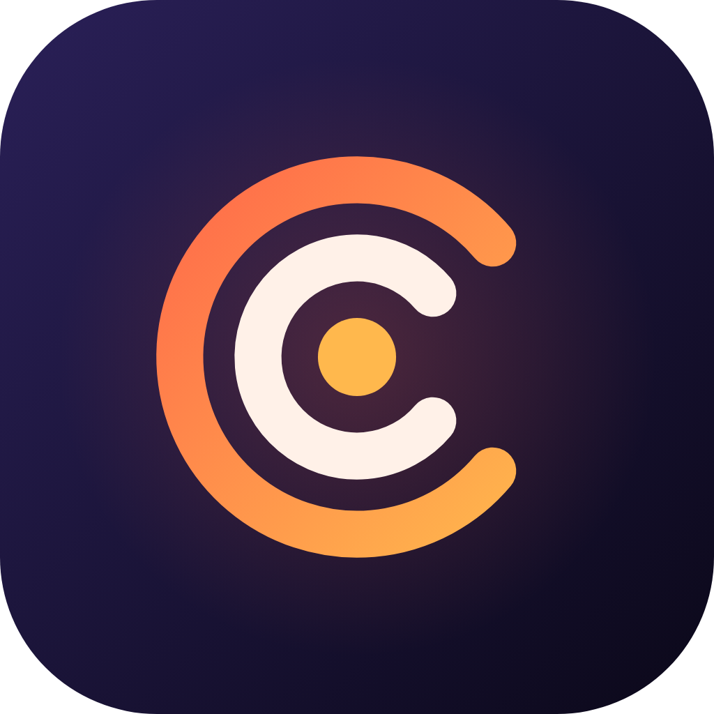

<p align="center"></p>

# Cadence

> *Your music, in rhythm.*

A personal, open-source Android music player that

* plays the **local files** on your device (gapless, ReplayGain, equalizer, sleep timer, Android Auto / Bluetooth controls),
* **downloads** audio from YouTube, SoundCloud, Bandcamp, the Internet Archive and ~1000 more sites through **yt-dlp** (on-device, or via a small companion server),
* **identifies and tags** tracks with **AcoustID fingerprints + MusicBrainz**, writing proper tags into the files,
* fetches **cover art** (Cover Art Archive → iTunes → Deezer → Last.fm → embedded),
* shows **synced lyrics** (LRCLIB) with a link to the Genius page,
* has a **dashboard** to manage the library: health overview, then edit, merge and bulk-fix artists and albums (changes are written into the files' tags too),
* adds scrobbling (Last.fm / ListenBrainz), artist pages, radio, podcasts, playlist import, smart playlists and more.

Built with Flutter + native Kotlin/Java plugins. The roadmap it follows is [MUSIC_PLAYER_PLAN.md](MUSIC_PLAYER_PLAN.md).

> **Legal note.** Downloading from YouTube breaks YouTube's terms of service, so this app is not for Google Play
> (distribute via GitHub Releases / F-Droid, keep it personal). Only download what you have the right to:
> your own uploads, Creative Commons / public domain music, or things you bought. See *Settings → About & legal*.

## Getting started

```bash
flutter pub get
cp env.example.json env.json            # optional: put your API keys here (git-ignored)
flutter run --dart-define-from-file=env.json
```

All keys are optional and can also be typed into *Settings → Accounts & API keys*:

| Key | Where to get it | Used for |
|---|---|---|
| AcoustID application key | acoustid.org/new-application | fingerprint identification |
| Last.fm API key + secret | last.fm/api/account/create | scrobbling, similar tracks, bios |
| ListenBrainz token | listenbrainz.org/settings | scrobbling |
| Genius token | genius.com/api-clients | song info + link (no lyrics text) |
| fanart.tv / Discogs / Jamendo / Podcast Index / Spotify | their developer pages | artist images, credits, sources, playlist import |

Set a contact in *Settings → Accounts* – MusicBrainz requires a descriptive User-Agent.

### Requirements

Flutter (stable), JDK 17, Android SDK 37. minSdk is 26 (Android 8). iOS is not built here: use the
[companion server](server/README.md) and sideload.

## Project layout

```
lib/
  core/        settings, SQLite schema + repositories, HTTP (rate limiting, cache, retry)
  platform/    Dart side of the native bridges
  features/
    playback/    audio handler (just_audio + audio_service), queue persistence, ReplayGain, sleep timer
    library/     MediaStore + SAF scanner (incremental)
    downloader/  yt-dlp arguments, engines (on-device / server / direct), queue, post-processing pipeline
    metadata/    Chromaprint (Dart port), AcoustID, MusicBrainz, identification, tag writing
    cover/ lyrics/ integrations/ sources/
  app/ ui/     dependency wiring, Material 3 UI
android/…/     MediaStorePlugin, TagsPlugin (+TagIO.java), AudioDecoder, YtDlpPlugin, DownloadService
server/        FastAPI + yt-dlp + ffmpeg companion (Docker)
tool/          fpcalc comparison, JVM tag test, canary script
test/          unit + provider tests (recorded API fixtures under test/fixtures)
```

## Testing

```bash
flutter analyze && flutter test        # ~340 tests: parsers, DB, providers (recorded responses), download pipeline
bash tool/jvm_tag_test.sh              # tag writing on real MP3/FLAC/M4A/OGG files (JVM)
dart run tool/compare_fpcalc.dart song.ogg --fpcalc /path/to/fpcalc   # Chromaprint port vs reference
cd server && pytest
```

CI builds and tests on every push; a weekly canary checks that yt-dlp can still download from the key sites.

## Known limitations

* **Opus files cannot be tagged in place** (jaudiotagger has no Opus writer); their tags live in the app database.
  The default download format is therefore M4A.
* **Tag edits to files the app did not create** need one Android write-access prompt (MediaStore write request) on Android 11+.
* **Fade between songs** is a fade-out/fade-in, not a true overlapping crossfade.
* The iOS app is not built; iOS needs a Mac to package and the companion server for downloads.

See [docs/RELEASE.md](docs/RELEASE.md) for signing and publishing, and [CHANGELOG.md](CHANGELOG.md).

## License

GPL-3.0-or-later (see [LICENSE](LICENSE)). yt-dlp is Unlicense, ffmpeg builds are GPL, jaudiotagger is LGPL, the Chromaprint algorithm is MIT.

## Brand

Name **Cadence**, palette "midnight ink" (`#0B0819`) with a coral-to-amber accent (`#FF6B4A` -> `#FFB84D`), headings in Sora (SIL OFL, `assets/fonts`). Tokens live in `lib/app/brand.dart`; the logo is drawn once in `lib/ui/widgets/brand_logo.dart`. Regenerate the PNG icons after changing it with `flutter test tool/generate_brand_assets_test.dart` (the Android adaptive-icon vectors in `res/drawable/ic_launcher_*.xml` mirror the same shape and are edited by hand).
